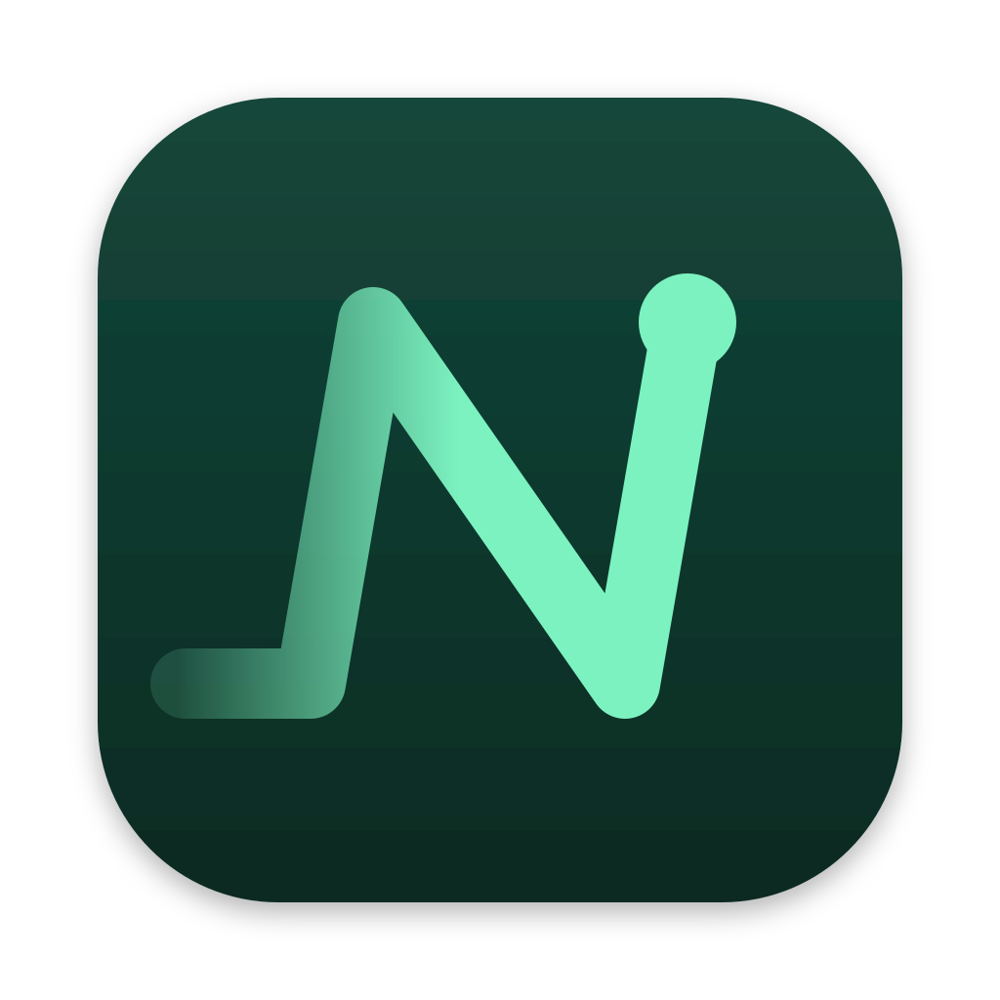
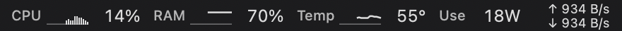
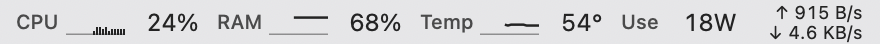

# Nadi

Nadi (Javanese and Indonesian for *pulse*) is a macOS menu bar app for live system vitals: CPU, memory, temperature, power and network. Click the menu bar item to open a panel with 10-minute charts, per-core load, GPU, fans, battery details and top processes.




## Requirements

- Apple Silicon Mac on macOS 14 Sonoma or later.
- To build from source: Swift 6 (Xcode 16+ or Command Line Tools).

Tested on a MacBook Pro M1 Max (macOS 27.0.1). Sensor keys vary across M1 to M4 chips; if a reading is missing on your Mac, see [CONTRIBUTING.md](CONTRIBUTING.md).

## Install

1. Download `Nadi-<version>.zip` from [Releases](https://github.com/theyudhiztira/nadi/releases).
2. Unpack `Nadi.app` and drag it into `Applications`.
3. Open `Nadi` from `Applications`. macOS blocks the first launch because the app is ad-hoc signed, not notarized. Close the dialog, open System Settings > Privacy & Security, and click Open Anyway.

Or strip the quarantine flag from the terminal:

```sh
xattr -dr com.apple.quarantine /Applications/Nadi.app
```

Verify a download against its checksum file:

```sh
shasum -a 256 -c Nadi-<version>.zip.sha256
```

## Build and run

```sh
git clone https://github.com/theyudhiztira/nadi.git
cd nadi
scripts/bundle.sh
open Nadi.app
```

Run tests:

```sh
swift test
```

Debug flags:

```sh
.build/release/Nadi --dump 5                              # five snapshots on stdout
.build/release/Nadi --render-panel panel.png light        # panel PNG (`light` or `dark`)
.build/release/Nadi --render-settings settings.png light  # settings PNGs (`light` or `dark`)
```

## Features

- Menu bar strip with live graphs and values. Pick, reorder or hide metrics in Settings; if all metrics are hidden, the app icon stays in the menu bar.
- Panel with 10-minute history charts, per-core efficiency and performance bars, memory pressure and swap, CPU/GPU temperatures, GPU power, fans, adapter and battery stats, network, disk and top processes with app icons.
- Keep-awake toggle in the panel for closed-lid operation (`pmset -a disablesleep`). The first toggle prompts once for admin approval to install `/etc/sudoers.d/nadi-keep-awake` for those two `pmset` commands. Nadi resets sleep on quit and on launch recovery. Remove the rule anytime with `sudo rm /etc/sudoers.d/nadi-keep-awake`.
- Settings window for menu bar metrics, refresh interval (0.5 to 5 s), Celsius or Fahrenheit, and Open at login (`SMAppService`).
- Update notice that checks GitHub Releases on launch and once a day, with a Download button.
- Sensors run without `sudo`. Measured on an M1 Max with the panel closed: 0.71 to 0.73% CPU over 90 s and 42 MB of memory.

Not built yet: 24-hour history in SQLite.

## Private APIs

| Reading | Source |
|---|---|
| CPU/GPU temperature, fan speed, system power | `AppleSMC` IOKit service |
| CPU temperature fallback | `IOHIDEventSystemClient` |
| GPU power | `IOReport` |

CPU load, memory, network, disk, battery and processes use public APIs and IOKit properties. If a private sensor fails on a macOS update, that metric shows `--` and the rest of the app keeps working.

## Privacy

Nadi queries GitHub's Releases API on launch and every 24 hours to check for updates. It sends no other network traffic, collects no telemetry and keeps sensor samples in memory.

## Releases

Pushing a `v*` tag builds the ZIP on GitHub Actions and opens a draft release. See [docs/RELEASING.md](docs/RELEASING.md).

## Project layout

| Path | Contents |
|---|---|
| `Sources/NadiCore` | Models, ring buffers, counter math, formatting, settings and sampler (no AppKit/IOKit). |
| `Sources/NadiSensors` | Sensor readers. |
| `Sources/CPrivate` | C headers for private IOKit/SMC interfaces. |
| `Sources/NadiApp` | Status item, menu bar renderer, panel and Settings window. |
| `Tests/NadiCoreTests` | Unit tests (Swift Testing). |
| `scripts/` | `bundle.sh` and `make-zip.sh`. |

## Contributing

See [CONTRIBUTING.md](CONTRIBUTING.md). Report security issues via [SECURITY.md](SECURITY.md).

## License

[MIT](LICENSE). Copyright © 2026 Pandu Yudhistira Wicaksono.
