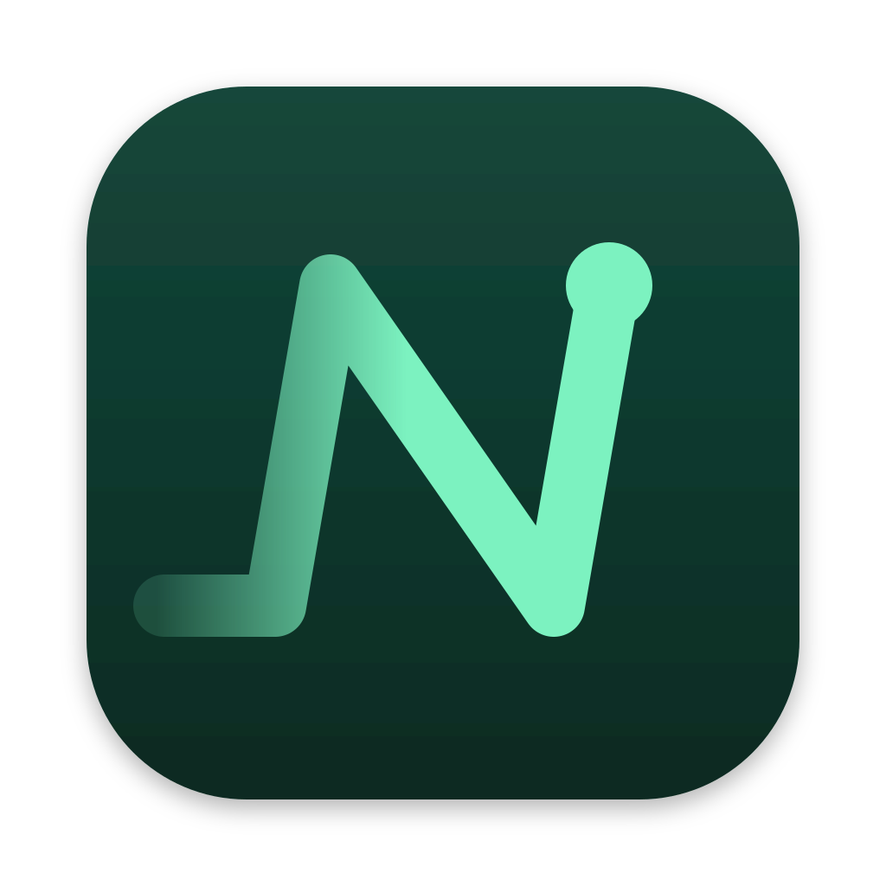
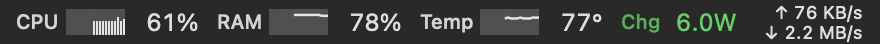
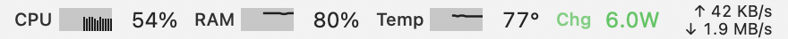

# Nadi

Nadi (Javanese and Indonesian for *pulse*) is a macOS menu bar app that shows live system vitals as small graphs: CPU, memory, CPU temperature, power draw and network traffic. Click the menu bar item to open a panel with history charts, per-core load, fans, battery details and the top processes.




Status: pre-release. Download a build from the [Releases page](https://github.com/theyudhiztira/nadi/releases) or build it from source. See [What works today](#what-works-today).

## Requirements

- Apple Silicon Mac. Intel is not supported.
- macOS 14 Sonoma or later.
- To build from source: a Swift 6 toolchain, from Xcode 16 or later or the Command Line Tools that ship Swift 6.

Nadi has only been tested on one machine: a MacBook Pro M1 Max on macOS 27.0.1. Sensor names differ between chip generations, so readings on M2 to M4 chips may be missing or wrong. Reports are welcome, see [CONTRIBUTING.md](CONTRIBUTING.md).

## Install

1. Download `Nadi-<version>.zip` from the [Releases page](https://github.com/theyudhiztira/nadi/releases).
2. Double-click the ZIP in Downloads to unpack `Nadi.app`. Safari may have unpacked it already.
3. Drag `Nadi.app` into Applications.
4. Open Nadi from Applications. macOS blocks it the first time. Close the dialog.
5. Open System Settings, go to Privacy & Security, scroll down to the message about Nadi and click Open Anyway. Confirm with your password or Touch ID.

Nadi then opens normally from now on. It has no Dock icon: look for it in the menu bar.

macOS blocks the first launch because Nadi is signed ad hoc, not with a paid Apple Developer ID, and Apple has not notarized it. The source of every release is in this repository, and you can build the same app yourself (see below).

If you prefer the terminal, this removes the download flag instead of steps 4 and 5:

```sh
xattr -dr com.apple.quarantine /Applications/Nadi.app
```

Each release also has a `.sha256` file. To check the download, put both files in the same folder and run:

```sh
shasum -a 256 -c Nadi-<version>.zip.sha256
```

It prints `OK` when the ZIP matches.

## Build and run

```sh
git clone https://github.com/theyudhiztira/nadi.git
cd nadi
scripts/bundle.sh
open Nadi.app
```

`scripts/bundle.sh` builds a release binary, wraps it into `Nadi.app` and signs it ad hoc. The app has no Dock icon: look for it in the menu bar. Quit it from the footer of the panel.

To run the tests:

```sh
swift test
```

Two debugging flags skip the menu bar and print to the terminal or a file:

```sh
.build/release/Nadi --dump 5                              # five snapshots on stdout
.build/release/Nadi --render-panel panel.png light        # panel as an image, or `dark`
```

## What works today

- Menu bar graphs for CPU, RAM, CPU temperature, power and network. Power shows the watts going into the battery while charging, and the whole-system draw otherwise. A metric over its alert threshold turns red.
- A panel with sections for CPU (per core, efficiency and performance cores), memory (pressure and swap), temperatures, GPU, fans, power and battery, network, disk and the top processes by CPU or memory. Charts cover the last 10 minutes.
- Sensors that need no `sudo`.
- An "Open at login" checkbox in the panel. It registers Nadi.app with macOS, so it shows up in System Settings under General, Login Items, where it can also be turned off. Move Nadi.app to its final folder before you turn it on.
- Measured on the M1 Max: 0.71 to 0.73% CPU over 90 seconds and 42 MB of memory with the panel closed.

Not built yet, in this order: a 24-hour history stored in SQLite, a settings window (choose menu bar metrics, refresh rate, °C or °F), and alerts.

## Private APIs

Some readings have no public API, so Nadi reads them through undocumented interfaces:

| Reading | Source |
|---|---|
| CPU and GPU temperature, fan speed, system power | SMC, through the `AppleSMC` IOKit service |
| CPU temperature fallback | `IOHIDEventSystemClient` |
| GPU power | `IOReport` |

Everything else (CPU load, memory, network, disk, battery, processes) uses public APIs and IOKit properties.

What this means for you:

- A macOS update can break a reading. Each sensor sits behind its own reader and returns nothing on failure, so the panel shows a dash for that metric and the app keeps running.
- An app that uses these interfaces cannot go on the Mac App Store.
- On macOS 27.0.1 the `IOReport` energy counters for CPU, ANE and DRAM do not move for an unprivileged process, so Nadi does not show them. CPU and system power come from SMC keys instead.

## Privacy

Nadi makes no network connections and collects no telemetry. It reads local sensors and keeps the samples in memory.

## Releases

Pushing a version tag builds the ZIP on GitHub Actions and opens a draft release. The steps are in [docs/RELEASING.md](docs/RELEASING.md). A copy you build yourself with `scripts/bundle.sh` has no download flag and opens without the Gatekeeper prompt.

## Project layout

| Path | Contents |
|---|---|
| `Sources/NadiCore` | Models, ring buffers, counter math, formatting, the sampler. No AppKit or IOKit imports, so it is unit-tested. |
| `Sources/NadiSensors` | The real sensor readers. |
| `Sources/CPrivate` | C declarations for the private interfaces. |
| `Sources/NadiApp` | Status item, menu bar renderer and SwiftUI panel. |
| `Tests/NadiCoreTests` | Unit tests (Swift Testing). |
| `scripts/` | `bundle.sh` builds and signs `Nadi.app`. |

## Contributing

Read [CONTRIBUTING.md](CONTRIBUTING.md) first. Security issues go through [SECURITY.md](SECURITY.md), not the public tracker.

## License

[MIT](LICENSE). Copyright © 2026 Pandu Yudhistira Wicaksono.
